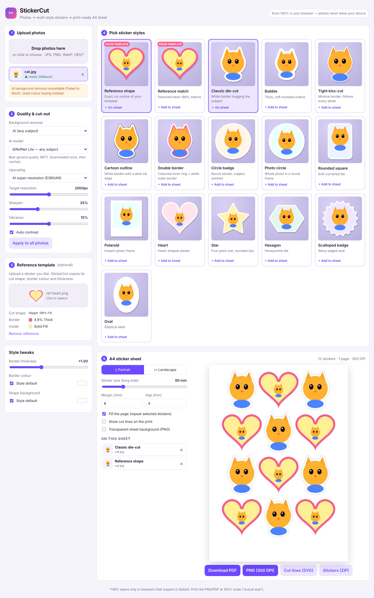

# StickerCut ✂️

Turn any photo into high-quality stickers in many cutting styles and get a
print-ready **A4 sheet** (300 DPI) with matching cut lines.



Everything runs **in the browser**. Photos are never uploaded to a server.

## Features

| Step | What it does |
| --- | --- |
| **1. Upload** | Drag & drop one or many photos (JPG, PNG, WebP; HEIC in Safari). |
| **2. Quality & cut-out** | **AI super-resolution** (ESRGAN via TensorFlow.js, WebGL) or classic high-quality upscaling up to a target resolution; auto-contrast, vibrance, unsharp-mask sharpening. **AI background removal** (BiRefNet Lite or MODNet via transformers.js, WebGPU/WASM), colour-key for plain backdrops, or keep the background. |
| **3. Reference template** *(optional)* | Upload a sticker you like. StickerCut detects its **cut shape** (circle, oval, rounded/square, heart, star, hexagon, scalloped, or free-form die-cut), **border colour & thickness**, **ink outline**, and **inside fill / photo**. You get two styles: *Reference shape* (the exact silhouette as the cut line) and *Reference match* (closest parametric shape with the same border). |
| **4. Styles** | 14 presets: classic die-cut, bubble, tight kiss-cut, cartoon outline, double border, circle badge, photo circle, rounded square, polaroid, heart, star, hexagon, scalloped badge, oval. You can override border thickness and colours globally. |
| **5. A4 sheet** | Portrait/landscape, sticker size in mm, margins, gaps, fill-the-page or exact copies (multi-page). |

### Exports

- **PDF** (A4, image at 300 DPI, optional vector cut lines in magenta)
- **PNG** at 300 DPI (2480 × 3508 px, DPI stored in the file), optionally with a transparent background
- **SVG cut file** in millimetres for Cricut Design Space, Silhouette Studio, Brother ScanNCut, laser cutters…
- **ZIP of individual stickers** as transparent 300-DPI PNGs (good for Cricut *Print Then Cut*)

Print at **100% / “Actual size”** so the sizes in mm are correct.

## Getting started

```bash
npm install
npm run dev        # http://localhost:5173
npm test           # unit tests (distance transform, masks, tracing, layout, PNG DPI)
npm run build      # static site in dist/
```

`npm run dev` and `npm run build` copy the ESRGAN weights from
`@upscalerjs/esrgan-slim` into `public/models/` first. You can host `dist/` on
any static host. The included GitHub Actions workflow tests the app and
deploys it to **GitHub Pages** on every push to `main`. To turn it on, go to
*Settings → Pages → Source: GitHub Actions*.

## How it works

- **Die-cut borders** use an exact Euclidean distance transform of the
  subject mask. *Bubble* styles add a morphological closing, which gives
  rounder outlines and bridges gaps. Holes are filled so each sticker is one
  piece.
- **Shaped stickers** are rasterised from vector paths. The artwork goes into
  the largest rectangle that fits inside the shape.
- **Cut lines** are traced from the final cut mask with marching squares and
  simplified with Ramer–Douglas–Peucker.
- **Reference analysis** keys out the template's backdrop (or uses its alpha
  channel) and scores the silhouette against every shape by IoU. It then
  reads 1-px colour rings inwards from the edge to measure the outline, the
  border and the fill.

## Notes & limits

- The AI models download once on first use (from the Hugging Face Hub and
  jsDelivr) and the browser caches them. If they can't load (offline, or
  blocked by a network policy), the app falls back to colour keying and shows
  a warning.
- AI upscaling needs WebGL. Without it, the app uses classic upscaling.
- Model licences: BiRefNet (MIT), MODNet (Apache-2.0), ESRGAN-slim weights (MIT).

## Project layout

```
src/
  lib/          image-processing core (framework-free, unit-tested)
    edt.ts        exact distance transform
    mask.ts       masks: offset/closing/erode/blur, components, holes
    trace.ts      marching-squares vectorisation + simplification
    background.ts AI + colour-key background removal
    enhance.ts    ESRGAN tiles, classic upscale, levels, vibrance, sharpen
    shapes.ts     shape paths, rasterisation, inscribed rectangle
    styles.ts     style presets & tweaks
    sticker.ts    renders a sticker + its cut mask
    reference.ts  reference/template analysis
    sheet.ts      A4 layout & page rendering
    export.ts     PNG DPI, PDF, SVG, downloads
  components/   React UI (dropzone, style gallery, sheet panel)
```
